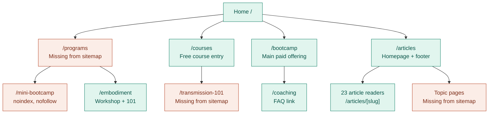
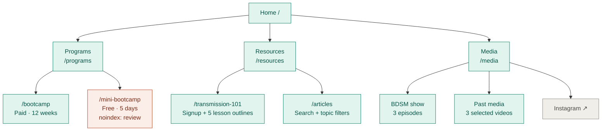

# Website redesign — content decisions

Date: 17 October 2026  
Status: working review document; decisions below do not change the website automatically.

## Direction

Start barebones. Keep the public pages clear and useful; add detail deliberately.
Preserve the existing website infrastructure and working content routes while simplifying what visitors see.

This document separates:

- **Confirmed:** choices already made in the website discussions.
- **Current:** what the redesign implements today.
- **Proposed:** the minimum content to keep; open for review.
- **Pending:** facts or policies that need confirmation.

Use the decision fields one at a time. Leaving something blank means it remains undecided.

## 1. Old site topology

Read top to bottom. Arrows show the main visitor links; repeated links are omitted. Teal = main visitor route, coral = a known item to review, gray = a secondary or external destination. These colors do not certify SEO health.

Programs also links to Bootcamp and Transmission 101; Courses also links to Embodiment. Those repeated links are omitted to keep the branches readable.

**Away from the main visitor path:**

| Group | Destinations | Note |
|---|---|---|
| Section archives | `/view`, `/cohort`, `/spotlight`, `/essays` | In the old sitemap; absent from the main navigation |
| Learning | Transmission 101 course and five lesson readers | In the old sitemap; separate from the signup landing page |
| Email access | `/courses/library` | Unlisted; link delivered by Kit |
| External | Store ↗ · YouTube ↗ · Instagram ↗ | Header and/or footer destinations |
| Legal | Terms · Privacy · Refund Policy | Footer links |

The old homepage also contained cohort announcements, a free-course preview, recent articles, a dissertations placeholder, and a newsletter. Its footer linked to Articles, YouTube, Terms, Privacy, Refund Policy, Instagram, company details, and contact email.

Supporting routes are kept separate from the visitor map so existence is not confused with navigation:

| Group | Existing routes |
|---|---|
| Public offerings | `/bootcamp`, `/mini-bootcamp`, `/coaching`, `/embodiment` |
| Writing | `/articles`, `/articles/[slug]`, `/articles/topics/[tag]`; section archives `/view`, `/cohort`, `/essays`, `/spotlight` |
| Course access | `/transmission-101`; `/courses/library` is unlisted and emailed after signup |
| Transmission 101 | `/courses/transmission-101-staying-present`, its `/[lesson]` readers and `/debrief` |
| Illumination 101 | `/courses/illumination-101` and its `/[lesson]` readers |
| Recordings | `/courses/videos/[package]`, its `/[video]` readers and `/playlists/[playlist]`; `/videos` is the legacy video entry |
| Team and other | `/team`, `/team/[initiate]` (promotion controlled by flag), `/lab/mandala` |

The course library is unlisted, not protected by a server authentication gate.

## 2. New site topology — current redesign

This is the replacement inside the existing Next.js app, reviewed through `c1885e7`. Local review: <http://127.0.0.1:8765>. Read the three main branches first; email access and footer links sit below the map.

BDSM show, Past media, and Instagram are sections of `/media`, not separate pages.

| Below the main map | Next step |
|---|---|
| Course signup | Kit welcome email → unlisted `/courses/library` → courses and lessons |
| Article archive | `/articles` → 23 complete article readers |
| Shared footer | Newsletter · Terms · Privacy · Refund Policy · social links · contact |
| Existing secondary routes | Coaching, Embodiment, learning, recordings, team, and other routes remain available |

- The homepage also links directly to Bootcamp and Mini Bootcamp, and participant stories link to their original videos.
- The course landing has exactly one email form inside the hero. After confirmation, the existing Kit welcome sequence delivers the unlisted library link; the full courses, lessons, and playback remain available.
- The shared footer includes Terms, Privacy, and Refund Policy on the current origin. Those pages use the Field Guide presentation with unchanged policy text. The course landing uses its hero form instead of repeating the footer signup.
- Coaching and Embodiment survive by URL but are not promoted in the new primary navigation. Basecamp remains hidden.
- Supporting writing, learning, playback, team, legal, and other existing routes in the table above remain available. The review decisions below are unchanged.

### URL continuity

| Old or prototype URL | Current destination / behavior |
|---|---|
| `/courses` | `/resources`; child learning routes remain available |
| `/journal/*` | `/articles/*` |
| `/conversation` | `/media` |
| `/field-guide/*` | Matching clean routes; journal/conversation map to articles/media |
| `/pricing` | `/bootcamp?tab=pricing`, scrolling to tuition |
| `/clips/*` | `/courses/videos/*` |
| `/ppw` | `/mini-bootcamp` |
| `/ppw-package-april-2026` | Full Transmission 101 course |

## 3. Confirmed choices

- [x] Keep the homepage short: invitation, offerings, participant proof, mailing list.
- [x] Use Field Guide as the primary visual direction.
- [x] Header: Programs, Resources, Media; no Contact or standalone Blog item.
- [x] Resources uses columns, not tabs; the course has its own page.
- [x] Course signup sits inside the hero, with one course form.
- [x] Media uses columns, with the BDSM show in its own section.
- [x] Keep Basecamp hidden and remove Embodiment from primary promotion.
- [x] Show tuition only at the end of the Bootcamp page.
- [x] Preserve the original app, analytics, Kit delivery, content, playback, hosting configuration, and URL continuity.

## 4. Proposed barebones content

These are proposals for the minimum useful pages, not instructions to restore every old section.

| Page | Minimum content | Leave out for now |
|---|---|---|
| Home | What CC is; invitation; two offerings; participant stories; mailing list | Curriculum, full schedule, tuition, long FAQs |
| Programs | Clear paid/free distinction, duration, next dates, links | Duplicate detail-page copy |
| Bootcamp | Who it serves; aim; what training involves; practical commitment; confirmed schedule; application next step; tuition/inclusions last | Long comparison tables, repeated sales sections, unsupported outcome claims |
| Mini Bootcamp | What it is; free/five days; confirmed dates/time/platform; simple week outline; registration status | Long duplicated Bootcamp explanations |
| Transmission 101 | Brief explanation of transmission; teacher; five-lesson preview; inline signup and delivery expectations | Separate repeated signup blocks |
| Resources | Course preview plus blog sidebar | Future-course placeholders |
| Articles | Searchable archive; author/date; complete readers | Extra editorial taxonomies unless useful |
| Media | A small selection of videos; BDSM show destination; Instagram | A duplicated full video library |

## 5. Content decision queue

For each item, choose **keep minimal / add now / later / omit** and leave notes. For policy items, use **confirm** before publishing facts.

### A. Explain the practice

**A1 — What is transmission?** The old course landing explained it; the new one jumps directly from the hero to lesson outlines.

Proposal: add one short explanation on the course page.

Decision: __________  
Notes / approved wording: __________

**A2 — Bootcamp curriculum and journey.** The old page named four pillars and a staged twelve-week progression. The new page gives three broader approach descriptions.

Proposal: a compact curriculum summary on Bootcamp; confirm any week-by-week promises before including them.

Decision: __________  
Notes: __________

### B. Make attendance and enrollment clear

**B1 — Schedule.** Restore only confirmed information: cohort start/end, daily commitment, session windows, weekly events, timezone/platform, and capacity if relevant. Mini's daily time is currently absent.

Decision: __________  
Confirmed details / owner: __________

**B2 — Application status.** The existing public site advertises priority registration; the redesign says the new form is being prepared and offers email contact. The meeting said Lori would supply the registration link.

Decision: __________  
Current registration link / status / owner: __________

**B3 — Tuition and inclusions.** Confirm price, payment plans, what continues after the cohort, and any private teachings. Old payment deadlines, referral discounts, and application requirements are not automatically current policy.

Decision: __________  
Confirmed inclusions / terms / owner: __________

**B4 — FAQ.** The new Bootcamp page keeps six practical questions out of the old seventeen.

Proposal: answer readiness, transmission, commitment, and access afterward without restoring the entire old FAQ.

Decision: __________  
Questions to keep: __________

### C. Help visitors find the next step

**C1 — Links between offerings.** The old course/Mini pages invited visitors onward to Bootcamp; Bootcamp also pointed to trying Mini first.

Proposal: one quiet next-step link on each detail page.

Decision: __________  
Notes: __________

**C2 — Coaching.** The page survives but lacks a clear entry from the redesigned public pages.

Decision: __________  
Placement / season status: __________

**C3 — Store.** The old Store link is absent. Earlier discussion left this for checking with John.

Decision: __________  
Placement / owner: __________

**C4 — Article and video discovery.** Articles remain complete; archive cards lost authors/dates and search covers less text. The full recording library survives, while Media is curated.

Decision: __________  
Restore authors/dates? __________  
Link to full recordings? __________

## 6. Technical items kept separate from content decisions

Starting barebones does not mean dropping working infrastructure.

| Item | Review status |
|---|---|
| GA4 | Existing initialization/property retained; external ingestion not verified by local checks |
| Kit | Original form ID and submission handler retained; welcome sequence/library-delivery wiring preserved; external email delivery not exercised |
| Learning content | Course routes, lesson bodies, playlists, and playback retained |
| Article content | All 23 source articles retained |
| Hosting | Existing Next.js/Netlify setup retained; production not deployed by these local iterations |
| Legal and URLs | Legal pages and legacy aliases retained |
| Social previews | Audit found missing `og:image` on redesigned public pages; fix before release |
| Mini indexing | Existing `noindex` remains; decide whether the public offering should be searchable |
| Signup analytics | Custom signup-success attribution was absent before redesign; separate improvement, not lost functionality |

## 7. Review log

| Date | Decision IDs | Decision / approved wording | Follow-up owner |
|---|---|---|---|
| | | | |
| | | | |
| | | | |

## Sources and scope

- Existing public website: <https://mindtraining.cc/>, especially `/bootcamp`, `/mini-bootcamp`, `/transmission-101`, `/coaching`, and `/programs`.
- Original app: `projects/cc-content-site` on `main` (`0081fbc` at audit time).
- Current redesign: `codex/cc-website-redesign`, reviewed through `1c0073f`; [PR #26](https://github.com/mindtraining-cc/cc/pull/26).
- Original/current route modules, shared navigation, content loaders, and redirect configuration were checked alongside the public pages.
- Meeting decisions and subsequent user corrections in this coordinator chat determine the confirmed choices above.
- This is a content/topology review. Old dates, prices, statistics, outcome statements, or policies are reference material until confirmed; no website changes are authorized merely by listing an option here.
